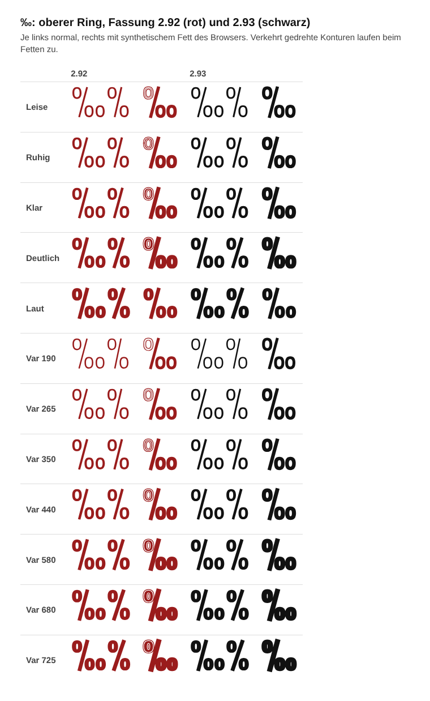
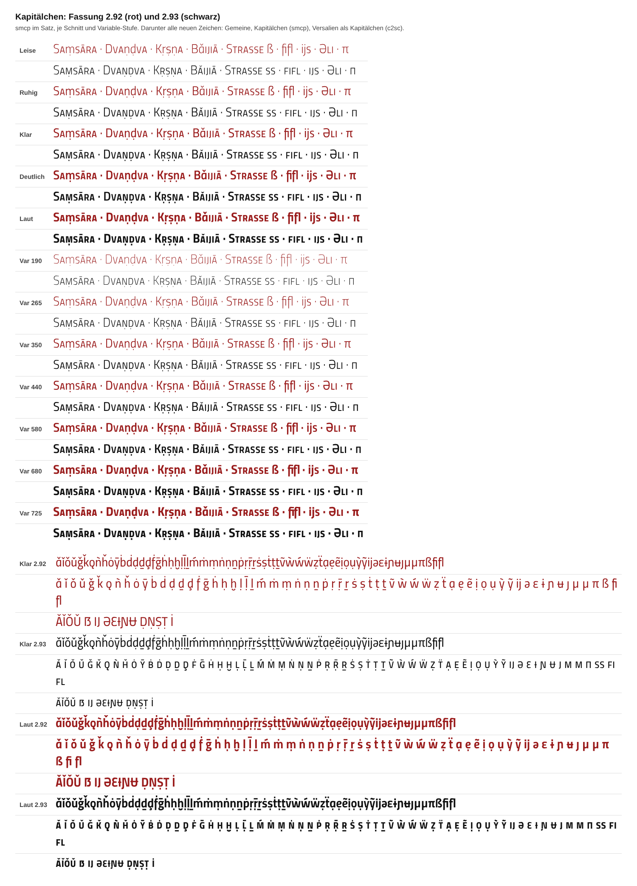
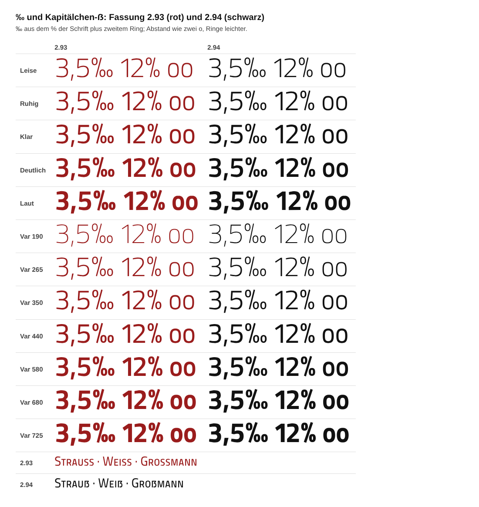

# Befund: Konturrichtung und Kapitälchen (Fassung 2.93)

Stand: 25. 11. 2026. Auftrag: Entscheide des Inhabers vom 25. 11. 2026.
Bau: `tools/goetheanum-fontfix/build_v293.py` (liest Fassung 2.92 aus git,
zweiter Lauf bitgleich geprüft). Prüfer: `tools/goetheanum-fontfix/konturrichtung.py`.
Bilder: `tools/goetheanum-fontfix/proof_v293.py`.

 <!-- typo-ok -->

 <!-- typo-ok -->

## Anlass

Im Umfrage-Dashboard des Inhabers stand ein kaputtes `%`. Ursache: eine alte
Kopie von v2.7 Deutlich (vor der Reparatur in `repair_variable_v28.py`); in
v2.9 ist `%` überall heil. Beim Nachmessen fiel `‰` auf: der obere Ring läuft
verkehrt herum (Aussenkontur mit dem Uhrzeigersinn, Punze dagegen). Beim
normalen Rendern unsichtbar, beim synthetischen Fett des Browsers läuft der
Ring zu (Bild oben, rote Spalte rechts). Geerbt aus v1.4.43.

## 1 Konturrichtung

Regel: eine Kontur, die Fläche umschliesst, läuft gegen den Uhrzeigersinn,
eine Punze mit ihm. Ob Fläche oder Punze, entscheidet das gerenderte Blatt
(ein Punkt knapp innerhalb der Kontur, Non-Zero über die ganze Glyphe), nicht
die Schachtelung allein; so zählen überlappende Teile (Strich der Null)
richtig. Gedreht wird nur, wo die gerenderte Fläche danach gleich bleibt, im
Variable Font nur, wo alle sechs Master denselben Befund zeigen.

Umgekehrt, in allen fünf Schnitten und der Variable (je 30 Glyphen):
`Ď Ģ Ķ Ļ Ņ Ŕ Ř Ș Ț ñ ; ‰ ļ ń ŗ ș ț ź ż ●`, Kommaakzent `̦`, dazu die
Kapitälchen von `ď ģ ķ ļ ņ ŕ ř ș ț` (bei Ď Ŕ Ř die ganze Glyphe, sonst der
Akzent oder ein Ring). Icons: 46 Glyphen; Pfeile: 8 Glyphen (Tasten `0 2 6 e h q t u`).

Belassen, weil sich das Blatt beim Umkehren ändern würde (Überlappung; eigens
anzusehen):
- `Å Ǻ` in Laut und am Master 725: Ring und A liegen dort übereinander.
- Variable: vier Glyphen ohne Codepunkt (Kapitälchen-Formen von Å Ǻ), nur am
  Master 725.
- Icons: `W R I T Z C H J Q F` (Piktogramme mit überlappenden Teilen).

## 2 Kapitälchen

65 neue Glyphen, je mit `smcp` (Gemeine) und `c2sc` (Versalie, wo es sie
gibt). Kerning: jede neue Glyphe erbt die Klassen ihres Grundbuchstabens.

- **Grundbuchstabe + Akzent** (52): `ǎ ǐ ǒ ǔ ǧ ǩ ǫ ǹ ȟ ȯ ȳ ḃ ḋ ḍ ḏ ḑ ḟ ḡ ḣ ḥ
  ḫ ḷ ḹ ḻ ḿ ṁ ṃ ṅ ṇ ṉ ṗ ṛ ṝ ṟ ṡ ṣ ṫ ṭ ṯ ṽ ẁ ẃ ẅ ẓ ẗ ạ ẹ ẽ ị ọ ụ ỳ ỹ`.
  Akzente oben vom Kapitälchen eines Spenders (`à á â ã ā ă ż ä å ő č`),
  zur Mitte wie dort. Akzente unten aus der Gemeinen selbst, waagrecht so
  zur Mitte wie in der Versalie der Schrift (`Ḷ`: Punkt unter der Mitte),
  auf Kapitälchengrösse verkleinert. Ogonek wie bei `ą`.
- **Aus der Versalie** nach dem Kapitälchen-Modell von `build.py` (Versalie
  bei Gewicht +110, Grösse 511/690, Laufweite 30): `ə ɛ ɨ ɲ ʉ`, dazu `c2sc`
  für `ẞ` (Kapitälchen-ẞ). Mischfaktor je Master an `H N O E S` gemessen;
  an `A D K R Z` nachgerechnet weicht das Modell höchstens 2,2 Einheiten
  von den vorhandenen Kapitälchen ab.
- **π**: Kapitälchen-Π aus Stamm und Höhe des Kapitälchen-H und dem Balken
  des Kapitälchen-T (die Schrift hat kein Π).
- **Zusammengesetzt**: `ij` = i + j (dazu `c2sc` IJ), `ß` = s + s, `fi` = f + i,
  `fl` = f + l.
- **Gleiche Form**: `µ μ` → Kapitälchen m, `ȷ` → j.
- **İ** (nur `c2sc`): Kapitälchen i mit Punkt (Türkisch).

Entscheide des Inhabers (26. 11.):
- `ß` → Kapitälchen-`ẞ` (ab Fassung 2.94; in 2.93 noch `ss`).
- `ƒ` bleibt ohne Kapitälchen: Gulden-Zeichen, die Schrift hat kein `Ƒ`.

Prüfung: `proof_variable_axis.py --alle` – 1004 Glyphen an sieben Stufen,
0 Verstösse.

## 3 Adressen

Unter `assets/fonts/goetheanum/Webfonts/` liefern die alten Adressen (v2.7,
v2.8) und neue Adressen ohne Fassungsnummer (`Goetheanum-Variabel.woff2`,
`Goetheanum-Schrift-Klar.woff2` …) die neueste Fassung
(`webfont_adressen.py`, nach jedem Schrift-Bau). Die Vergleichsdateien
`Befund/` liegen jetzt in `tools/goetheanum-fontfix/befund/` und werden nicht
mehr ausgeliefert; die Treibhaus-Seiten guillemets.html und schrift-v29.html
laden sie von raw.githubusercontent.com.

## 4 Fassung 2.94 (26. 11. 2026)

 <!-- typo-ok -->

Inhaber: ‰ ab Deutlich zu fett, die Ringe fliessen ineinander. Befund: Das
Zeichen stammte aus v1.4.43, die Ringe standen an festen Stellen und wurden
nur dicker; der Abstand der unteren schrumpfte von 52 auf 17 Einheiten. Ein
erster Vorschlag (Abstand wachsend, 52 → 68) wirkte unnatürlich weit.

Regel jetzt, gebaut in `build_v294.py`:
- `‰` ist genau das `%` der Schrift plus ein zweiter, gleicher unterer Ring.
- Die Ringe sind verkleinerte `o` (gleiche Proportion 0,81), also stehen sie
  so weit auseinander wie zwei `o` der Schrift, auf Ringhöhe verkleinert:
  Flüstern 60, Klar 49, Schreien 34 Einheiten.
- Die drei Ringe folgen dem Gewicht zu 85 %, damit die Punzen offen bleiben;
  der Schrägstrich folgt dem Schnitt (Entscheid «Ringe leichter»).

Dazu Kapitälchen `ß` → `ẞ` und das Kerning der Kapitälchen `ij fi fl` richtig
herum (in 2.93 vertauscht: rechts zählte der erste Teil).
