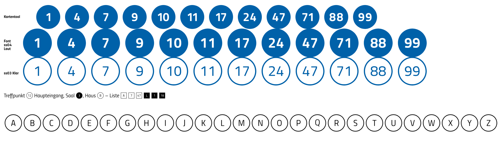

# Befund: Listenzeichen in Kreis und Quadrat (Etappe E3)

Stand: 2. 11. 2026. Auftrag: Etappe E3 aus `docs/recherche_titillium-pro.md`
(Entscheid des Inhabers vom 31. 10. 2026). Anschauung:
https://werkzeuge.goetheanum.ch/listenzeichen.html · Bau:
`tools/goetheanum-fontfix/build_v29_listen.py` (liest v2.9 aus git, idempotent,
zweiter Lauf bitgleich geprüft).

 <!-- typo-ok -->

## Ergebnis

| Stilset | Form | Inhalt |
|---|---|---|
| `ss03` | Kreis, Kontur | A–Z, 0–9, 10–99 |
| `ss04` | Kreis, gefüllt | A–Z, 0–9, 10–99 |
| `ss05` | Quadrat, Kontur | A–Z, 0–9, 10–99 |
| `ss06` | Quadrat, gefüllt | A–Z, 0–9, 10–99 |

Je Stilset 56 Glyphen: 36 fertige Zeichen (wie die Pro) und 20 Bausteine für
10–99 (erste Ziffer mit linker, zweite mit rechter Hälfte). Dazu 52 fertige
Paare für Unicode. Zusammen 276 Glyphen, 98 Codepunkte (569 → 667):
`⓪ ①–⑳ ㉑–㊿ Ⓐ–Ⓩ` zeigen `ss03`, `⓿ ❶–❿ ⓫–⓴` zeigen `ss04`. Quadrate und
gefüllte Buchstaben gibt es in Unicode nur ausserhalb der BMP (`🄰 🅐 🅰`,
teils als Emoji gezeigt); sie bleiben Stilset.

## Formen

Vorbild ist die Kreiszahl des Kartentools (`apps/karten-generator/app.js`,
`markenFormen`, Entscheid Auftraggeber 8. 7. 2026) und das Sonderelement
`.step-num` in `design-system/base.css`. Erste Fassung (#751) verworfen:
Ziffern zu gross im Kreis, nach der Tinte statt nach der Vorbreite
zentriert, zweistellige Zahlen kleiner als einstellige.

- **Kreis bleibt Kreis** (Inhaber, 2. 11.): 10–99 stehen im selben Kreis
  bzw. Quadrat wie ein Einzelzeichen, keine Pille.
- **Grösse wie im Kartentool:** Grad des inneren Zeichens = ½ Kreisdurchmesser,
  für eine, zwei Ziffern und Buchstaben gleich. Kreis 1200 Einheiten (1,2
  Geviert, wie die Pro), Zeichen auf 0,6. Quadrat 1116 (wirkt daneben gleich
  gross). Mitte auf halber Versalhöhe (345); im Fliesstext mit Zeilenhöhe
  1,66 bleibt der Kreis in der Zeile.
- **Optische Mitte:** senkrecht die Tintenmitte der Ziffern bzw. Versalien
  auf der Kreismitte (Kartentool: Grundlinie 0,33 Grad unter der Mitte);
  waagrecht nach der Vorbreite, nicht nach der Tinte – die Seitenränder der
  Schrift tragen die optische Mitte (eine 1 steht so, wie sie im Satz
  steht). Ziffern tabellarisch wie `.step-num`: jedes Paar steht dadurch
  genau auf der Mitte, obwohl jede Hälfte ihren Partner nicht kennt.
  J und Q (Unterlänge) nach der Tinte gemittelt.
- **Gewicht:** das innere Zeichen im Gewicht des Schnitts; in Laut gefüllt
  deckt sich die Form mit der Marke des Kartentools (angeschaut neben-
  einander, 1 bis 99).
- **Strich der Kontur** = Strich des verkleinerten Zeichens (0,6 × Stamm des
  I): 22 in Flüstern, 49 in Klar, 83 in Schreien; wächst mit dem Gewicht.
- **Gefüllt:** Fläche mit ausgespartem Zeichen; die Tinte nimmt mit dem
  Gewicht ab, das Prüfmass verlangt für diese Glyphen fallende Fläche.
- **Naht** der Bausteine in der Mitte, Hälften überlappen 16 Einheiten;
  in Browser und PDF ohne Haarlinie (Pixel geprüft).

## Technik

- Die Paarregel steht im Stilset selbst (nicht in `calt`), damit sie nur
  greift, wenn das Stilset an ist: Ziffer + Ziffer, ohne Ziffer davor und
  danach (zwei `ignore`-Regeln). `123` bleibt `①②③`. Eingaben sind alle
  Ziffernformen (`tnum`, `onum`, `zero` …). Mit HarfBuzz geprüft.
- Gebaut einmal an den sechs Mastern der Variable; die statischen Schnitte
  erhalten die Instanz der Variable an ihrem Gewicht (deckungsgleich).
- FeatureList jetzt nach Tag sortiert (auch das `ccmp` aus E2).
- Prüfmass `proof_variable_axis.py --alle`: 929 Glyphen, 0 Verstösse.

## Fassung statt neuer Version

Dateinamen bleiben **v2.9**, intern **Version 2.91** (`head.fontRevision`,
`name` 3/5). Gründe: nur Ergänzung, kein vorhandenes Zeichen und kein Mass
geändert, versandte Mails und rund 90 Einbindungen bleiben gültig. «2.10»
wäre als Zahl kleiner als 2.9 und würde von Betriebssystemen und Office als
ältere Datei gelesen; 2.91 wird als neuer erkannt. Webfonts gleichen Namens
können im Browser-Zwischenspeicher alt bleiben; die Anschauungsseite lädt
darum mit `?v=2.91`.

## Offen

- Das Kartentool zeichnet seine Marken weiter selbst (Kreis + Text). Es
  könnte künftig die Glyphen `ss04` setzen; Entscheid des Inhabers.
- Office: Stilsets kann Word (Schriftart › Erweitert), PowerPoint nicht;
  dort helfen die Unicode-Zeichen `①–㊿`.
