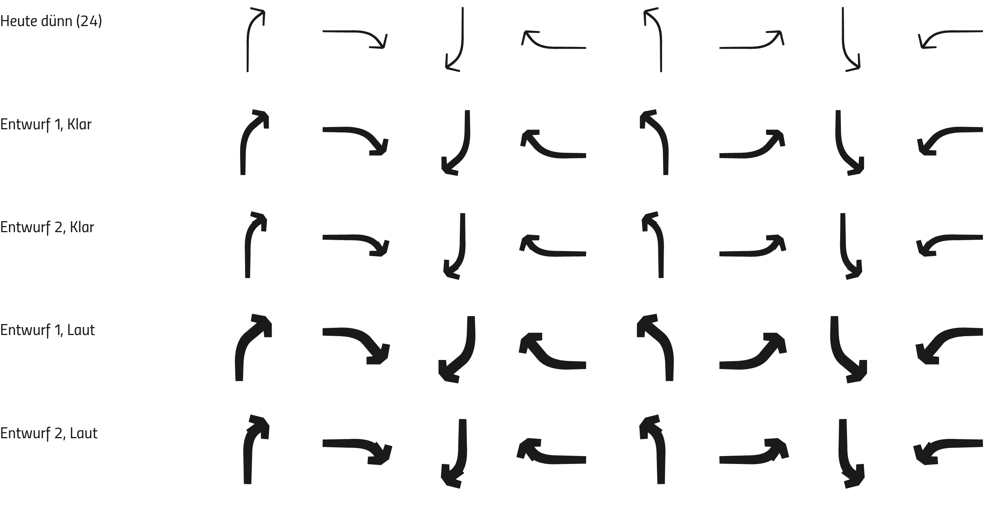
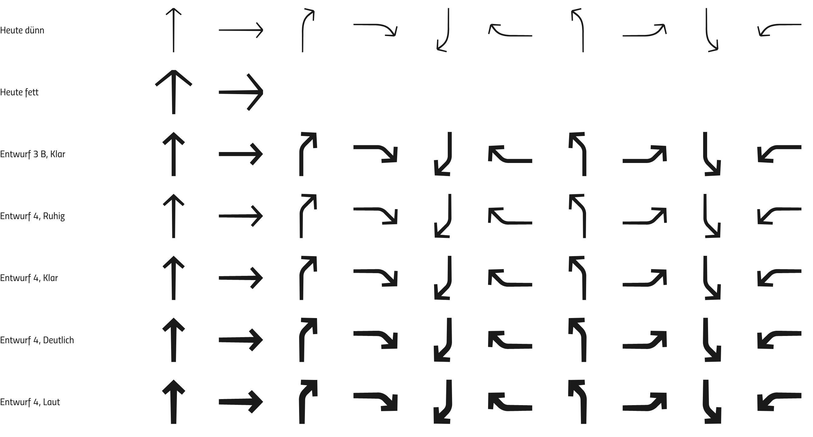
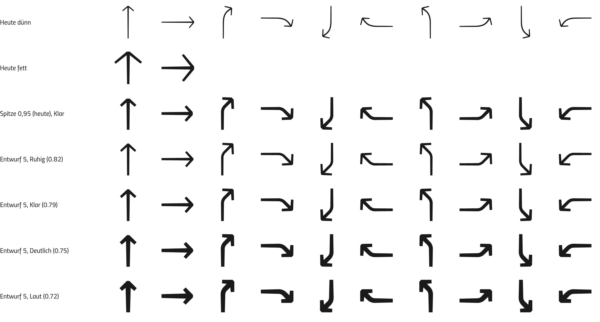
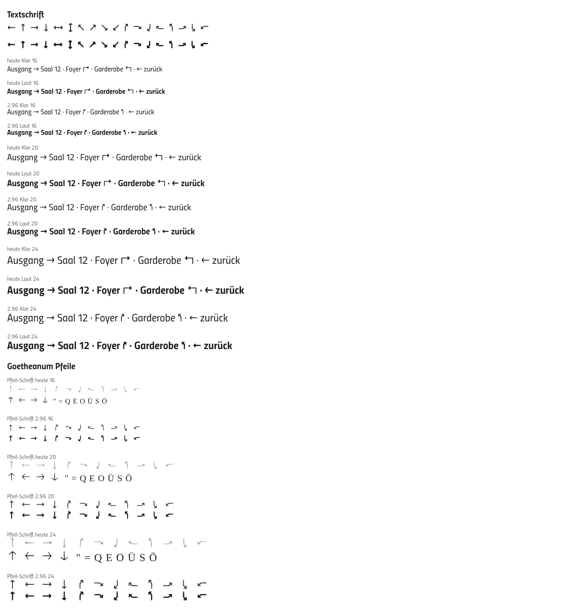

# Entwurf: Pfeil-Schrift in der Form der Textschrift (25. 11. 2026)

Auftrag des Inhabers (25. 11.): ‹ja, ich möchte die Entwürfe sehen› – der
offene Punkt aus `docs/befunde/pfeile-textschrift-2026-11-02.md`: die
‹Goetheanum Pfeile› auf die Form der Textschrift-Pfeile heben (ihre dünnen
Pfeile sind leichter als Flüstern). **Nur Entwurf und Bild, kein Paket,**
keine Schriftdatei geändert.

 <!-- typo-ok -->

- Bild: https://github.com/phtok/goeloggen/blob/main/docs/befunde/pfeile-schrift-entwurf-2026-11-25.png
  (Tafel als SVG: `pfeile-schrift-entwurf-2026-11-25.svg`)
- Bau: `tools/goetheanum-fontfix/entwurf_pfeile_textform.py` (zeichnet mit
  `kopf`/`pfeil` aus `build_v29_pfeile.py`, schreibt nur Bilder)

## Was der Entwurf tut

- **Form der Textschrift:** Arm 50° zum Schaft, stumpfe Spitze, Strich wird
  zum Ende schlanker (0,71 / 0,85 / 0,72), Kopf 0,27 × Länge + 0,9 × Strich –
  dieselbe Konstruktion wie → in der Textschrift.
- **Kasten der Pfeil-Schrift bleibt:** Länge 820, Mitte 500, Vorschub 1250,
  Belegung (6 t u h, 2 0 q e o ü s ö) unverändert.
- **Gewicht = Hausschnitt:** Strich = Minus des Schnitts, Ruhig 60 · Klar 74
  · Deutlich 97 · Laut 113. Heute: dünn 24, fett 58.
- **Gebogene Pfeile 1–8:** Mittellinie wie heute (senkrecht, Bogen, Spitze
  in 40°), Kopf und Verlauf der Textschrift. Die sieben anderen sind
  Spiegelungen und Drehungen von Nr. 1, wie in der heutigen Schrift (geprüft:
  100 von 100 Punkten). Mit wachsendem Strich rückt der Bogen tiefer und
  breiter, damit er offen bleibt (bei Laut 370 statt 236 breit).
- **Kompass 1–4:** nicht angefasst (Piktogramm mit Beschriftung).

## Beobachtet

- Im Satz bei gleichem Grad ist der Pfeil der Pfeil-Schrift **19 % länger**
  als → der Textschrift (820 gegen 691) und steht mit breitem Abstand
  (Vorschub 1250). Der Entwurf behält beides; erst so bleibt die Belegung
  austauschbar. Wer den Pfeil im Text will, nimmt ohnehin → der Textschrift.
- Klar (74) liegt im Satz neben Klar-Text im selben Gewicht; Ruhig (60) ist
  dem heutigen fett (58) am nächsten.

## Zu entscheiden

1. **Weiterbauen?** Empfehlung: **ja, zwei Gewichte Klar und Laut** – dünn
   wird Klar, fett wird Laut (Umschalt bleibt ‹fett›), gebogene Pfeile in
   beiden. Alternative: Ruhig und Deutlich, näher am heutigen Bild.
2. Bei ja: als Fassung der Pfeil-Schrift bauen (Dateiname bleibt, Version
   höher), Beipackzettel S. 5 nachziehen. Das ist ein Paket-Schritt; die
   Schwester-Session ‹Hausschrift 2.93› berührt dieselben Pakete – nach ihr.

## Rückmeldung und zweiter Anlauf (25. 11. 2026)

Inhaber: ‹Die Ableitungen der gebogenen Pfeile überzeugen noch nicht.›
Klargestellt: Der Entwurf betrifft nur die eigene Schrift ‹Goetheanum
Pfeile›; in die Textschrift kommt nichts hinzu (dort stehen ← → ↑ ↓ seit
Fassung 2.92).

 <!-- typo-ok -->

- **Entwurf 1** (oben beschrieben): eigene Mittellinie; der Bogen wird mit
  dem Gewicht tiefer und breiter.
- **Entwurf 2**: Schaft genau auf der Mittellinie der heutigen Glyphe
  (aus ihren beiden Kanten gemittelt), nur Strich, Verlauf und Kopf der
  Textschrift. Hält das heutige Bild, wird aber in Laut eng: der Kopf hat
  im schmalen Bogen (236 breit) kaum Platz.

## Kritik an Entwurf 1 (25. 11. 2026, auf Bitte des Inhabers)

Nachgemessen: Pfeil-Schrift → Vorschub 1250, Rand links 90 / rechts 340,
Mitte bei 500, Länge 820; Textschrift → (Klar) Vorschub 823, Rand 66 / 66,
Mitte 346, Länge 691.

1. **Die Satzprobe ist geschönt.** Sie setzt den Pfeil mittig in seinen
   Kasten und senkt ihn von Hand ab. Die echte Pfeil-Schrift steht
   asymmetrisch (90 links, 340 rechts) und 154 Einheiten höher als → der
   Textschrift. Im Satz wäre der Abstand hinter dem Pfeil fast viermal so gross
   wie davor.
2. **Der Strichverlauf gehört zur Schriftgrösse, nicht zum Piktogramm.** In
   der Textschrift fällt die Verjüngung (Ende 0,71 des Schafts) kaum auf; im
   grossen Pfeil wird sie zum Keil, ab Deutlich sichtbar wie ein Nagel.
3. **Kopf: zwei Identitäten.** Die heutigen Pfeile haben lange, offene Arme
   (7,6 × Strich); der Entwurf übernimmt den kompakten Textkopf. Ruhig (60)
   ist so schwer wie heute fett (58), wirkt aber gedrungener. Es ist nicht
   entschieden, ob die Pfeil-Schrift dem Text oder dem Leitsystem folgt.
4. **Spitze ohne Lichtfalle.** Ab Deutlich laufen Arme und Schaft an der
   Spitze zu einem dunklen Knoten zusammen.
5. **Gebogene Pfeile, Entwurf 1:** Der Bogen ändert sich mit dem Gewicht.
   Ruhig und Laut sind darum verschiedene Zeichnungen und nicht
   interpolierbar. Vor dem Kopf fehlt eine gerade Strecke; der Kopf sitzt im
   Bogen und wird ab Deutlich zum Klumpen. Die Spitze zeigt schräg (rund 40°)
   statt in die Ausfahrt, das gibt es schon heute: liest sich als ‹schräg
   rechts›, nicht als ‹rechts abbiegen›.
6. **Technik:** Die Konturen sind Polygone (rund 130 Punkte), keine Kurven.
   Gut für ein Bild, nicht baubar als Master.
7. **Es fehlt:** Gebrauchsgrösse (16–24 px, 1×), dunkel, Kompass im
   neuen Gewicht.

Folgerung für einen dritten Anlauf: erst entscheiden, wem die Pfeil-Schrift
folgt (Leitsystem oder Text); dann ohne Verjüngung, Kopf mit langen Armen und
Lichtfalle, gebogene Pfeile mit einer Geometrie für alle Gewichte (Radius für
das schwerste), Ausfahrt rechtwinklig mit gerader Strecke vor dem Kopf, als
Bézier-Master.

## Entwurf 3: gebogene Pfeile neu (25. 11. 2026)

Inhaber zu Entwurf 1 und 2: ‹crumpy, dumpf, stumpf. Finde bessere Lösungen!›

 <!-- typo-ok -->

Bau: `tools/goetheanum-fontfix/entwurf_pfeile_gebogen3.py` (nur Bild). Was
sich gegen 1 und 2 ändert, je als Antwort auf die Kritik oben:

- **Spitz statt stumpf:** Kopf als Winkel mit Gehrung, Arme 48° zur Achse,
  lang und offen (250 Einheiten, wie die Arme heute).
- **Hell statt dumpf:** gleichmässiger Strich ohne Verjüngung; der Schaft
  endet im inneren Scheitel des Kopfs, so bleibt dort eine Lichtfalle statt
  eines Knotens.
- **Klar statt crumpy:** Der Kopf sitzt auf einer geraden Strecke, der Bogen
  hat einen festen Radius (210) für alle Gewichte, also interpolierbar.
  Saubere Vereinigung der Formen (shapely), keine überlappenden Polygone.
- Die geraden Pfeile tragen denselben Kopf, damit die Familie eins ist.

Varianten:

| | Weg | Eindruck |
|---|---|---|
| A Winkel | senkrecht, Viertelkreis, waagrecht in die Ausfahrt | eindeutig ‹abbiegen›, Leitsystem-Sprache |
| B Schräg | senkrecht, Achtelkreis, schräg weiter | ‹schräg halten›; in Laut wirkt der Kopf wie eine Fahne |
| C Schwung | ein weiter Bogen, Kopf waagrecht | am lebendigsten, nimmt die weiche Geste von heute auf |
| D Heute | heutige Mittellinie, neuer Strich und Kopf | bleibt eng; in Laut gedrängt, verworfen |

Empfehlung: **C Schwung**, A als Alternative für ein strenges Leitsystem.

## Entwurf 4: schräg, mit Strichverlauf (26. 11. 2026)

Inhaber zu Entwurf 3: ‹Schräg kommt dem Entwurf am nächsten. Doch das
Gestaltungsprinzip scheint noch nicht voll erfasst zu sein: Die Balken
verjüngen sich leicht am Ende. Schau die Pfeile und die Titillium-Elemente
genauer an. Das gibt Dynamik und Eleganz.›

 <!-- typo-ok -->

Gemessen (senkrecht durch den Schaft von →):

| | Schwanz | am Kopf | Verhältnis |
|---|--:|--:|--:|
| Pfeil-Schrift dünn | 24 | 32 | 0,75 |
| Pfeil-Schrift fett | 58 | 72 | 0,81 |
| Titillium Sans Pro → (Thin, Regular, Bold) | gleich | gleich | 1,00 |

Die Hausschrift verjüngt Diagonalen leicht zum Knoten (v 80 → 76, y-Schwanz
79 → 74, je rund 5 %); die Pro-Pfeile haben keinen Verlauf. Der Verlauf ist
das eigene Merkmal der Pfeil-Schrift, die Titillium gibt ihr die Richtung
(schlanker zum Ende hin).

Entwurf 4 (`entwurf_pfeile_gebogen4.py`): Geometrie von 3 B, Schaft vom Kopf
zum Schwanz auf 0,78, Arme von der Wurzel (0,88) zum Ende (0,74), Innenkante
dadurch steiler, Spitze spitz, Lichtfalle im inneren Scheitel. Gerade und
gebogene Pfeile in Ruhig, Klar, Deutlich, Laut.

## Entwurf 5: flache Spitze, Verlauf mit der Fette (26. 11. 2026)

Inhaber zu Entwurf 4: ‹Die Pfeilspitze gehören flach, keine zu breite
Fläche! Die Verjüngung könnte mit der Fette deutlicher werden? Oder
widerspricht das gemessenen Details an den Urentwürfen aus Urbino?›

 <!-- typo-ok -->

Gemessen:

- **Urbino-Titillium** (`sources/Titillium-*Upright.otf`) hat **keine
  Pfeile**. Ihre Diagonalen verjüngen sich zum Knoten, **mit der Fette
  stärker**: v Thin 0,97 · Light 0,95 · Regular 0,95 · Semibold 0,93 ·
  Bold 0,91 (y-Schwanz 0,95–0,97).
- **Pfeil-Schrift heute** (aus dem Icon-Font, nicht aus Urbino): Schaft
  dünn 0,75, fett 0,81 – also umgekehrt. Nur zwei Gewichte, getrennt
  gezeichnet; kein Gesetz, eher Zufall der Zeichnung.
- **Spitze heute:** flach, 0,95 × Schaft.

Also kein Widerspruch zu Urbino: Ein Verlauf, der mit der Fette deutlicher
wird, folgt der Titillium. Entwurf 5 (`entwurf_pfeile_gebogen5.py`): Schaft
Ruhig 0,82 · Klar 0,79 · Deutlich 0,75 · Laut 0,72, Arme im gleichen Mass;
Spitze flach, 0,55 × Schaft breit (Vergleichsreihe mit 0,95 wie heute).

## Entscheid (26. 11. 2026, Inhaber: ‹ns em›)

Entwurf 5 angenommen (Variante B, flache Spitze 0,55, Verlauf Ruhig 0,82 …
Laut 0,72). Bauplan wie empfohlen:

1. **Pfeil-Schrift bleibt eigene Schrift** (Tastenbelegung, Kompass),
   neu gezeichnet nach Entwurf 5, als Kurven-Master, Gewichte dünn = Klar,
   fett = Laut (Umschalt bleibt ‹fett›).
2. **Grundschrift:** die zehn Pfeile ← ↑ → ↓ ↔ ↕ ↖ ↗ ↘ ↙ auf dieselbe Form
   heben (Fassung 2.94), dazu die acht gebogenen auf ↰ ↱ ↲ ↳ ⬏ ⬎ ⬑ ⬐
   (U+21B0–21B3, U+2B0E–2B11). Zuordnung: Pfeil-Schrift-Taste 2 (hoch, dann
   rechts) = ↱ usw.; prüfen, dass die schräge Spitze die Bedeutung trägt.
3. Kompass bleibt nur in der Pfeil-Schrift.

## Bau 2.96 (26. 11. 2026)

 <!-- typo-ok -->

- Schmal (375 px): https://github.com/phtok/goeloggen/blob/main/docs/befunde/pfeile-296-satzprobe-375.png
- Bau: `tools/goetheanum-fontfix/build_v296.py`, Form `pfeilform.py`, Probe
  `proof_v296.py` (Chromium, aus den Webfonts, heute aus git)

| | Pfeil-Schrift | Textschrift |
|---|---|---|
| Pfeile | 6 t u h, 2 0 q e o ü s ö, Kompass y x c v | ← ↑ → ↓ ↔ ↕ ↖ ↗ ↘ ↙ ↱ ⬎ ↲ ⬑ ↰ ⬏ ↳ ⬐ |
| Gewicht | Taste = Strich Klar (74), Umschalt = Laut (113) | Strich = Minus des Masters (34 … 120) |
| fett gebogen | neu: " = Q E O Ü S Ö (Schweiz è é) | – |
| Codepunkte | 51 (vorher 42) | 685 (vorher 677) |

- **Form.** Eine Kontur je Pfeil, gegen den Uhrzeiger, feste Punktfolge
  (Variable interpolierbar, `proof_variable_axis.py --alle`: 0 Verstösse);
  der Bogen ist eine Kurve je Seite, der Verlauf läuft durch ihn hindurch.
  Die flache Spitze liegt genau am Ende der Länge (Entwurf 5 schnitt sie
  hinter der Gehrung ab, rund 0,25 × Schaft kürzer).
- **Zuordnung** Pfeil-Schrift → Unicode: 2 ↱ · 0 ⬎ · q ↲ · e ⬑ · o ↰ · ü ⬏
  · s ↳ · ö ⬐.
- **Geprüft:** Konturrichtung Pfeil-Schrift 0 Glyphen (Schnitte unverändert
  zu 2.94); zweiter Lauf bitgleich; Kompass bitgleich übernommen.
- **Beobachtet, zur Abnahme:** In der Textschrift tragen die gebogenen Pfeile
  ihre Bedeutung erst ab rund 20 px; bei 16 px liest sich die 45°-Spitze
  von ↱ ↰ eher als Haken. Die Unicode-Vorbilder biegen um 90°.
- **Nicht angefasst:** Icon-Font und Einzeldateien (`pfeil-*.svg/png/pdf`)
  zeigen die alte Form; die Kursive (2.95) trägt die Pfeile der Pro.
