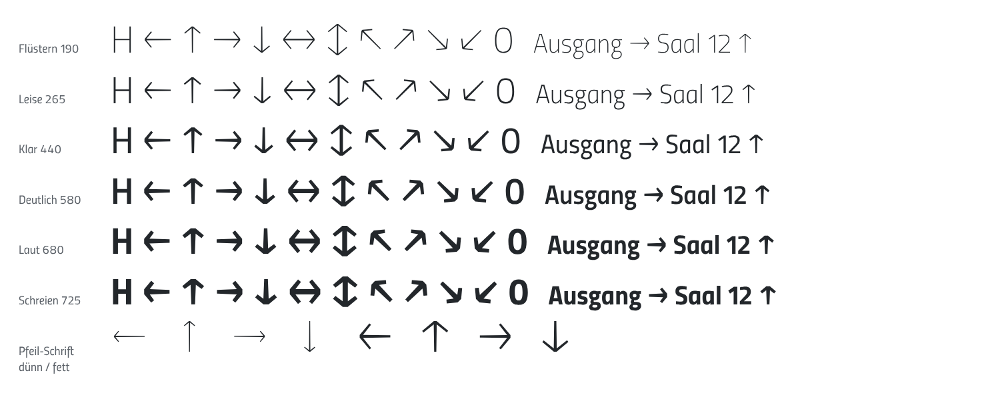

# Befund: Pfeile in der Textschrift (Fassung 2.92)

Stand: 2. 11. 2026. Auftrag: Entscheid des Inhabers vom 2. 11. 2026, «Pfeile
ja» – die offene Frage aus `docs/befunde/schrift-v29-titillium-pro.md` (§ 1
«Nicht übernommen», § «Offen») und `docs/recherche_titillium-pro.md` (E2).
Bau: `tools/goetheanum-fontfix/build_v29_pfeile.py` (liest Fassung 2.91 aus
git, zweiter Lauf bitgleich geprüft). Anschauung:
https://werkzeuge.goetheanum.ch/schriften.html (Eintrag «Pfeile»),
Beipackzettel S. 2.

 <!-- typo-ok -->

## Anlass

Wer in der Textschrift «Ausgang →» tippt, bekam bisher einen fremden Pfeil
aus einer Ersatzschrift, in Mails oft ein Emoji. Die ‹Goetheanum Pfeile›
bleibt daneben bestehen (Belegung auf normalen Tasten, Beipackzettel S. 5).

## 1 Codepunkte

Aufgenommen: `← ↑ → ↓ ↔ ↕ ↖ ↗ ↘ ↙` (U+2190–2199), in allen fünf Schnitten
und der Variable; 667 → 677 Codepunkte. Das ist der Block, den die Titillium
Sans Pro hat und den Tastaturen, Office und Mail-Programme als ‹Pfeil›
anbieten.

Nicht aufgenommen, mit Grund:
- **Fette Pfeile** der Pfeil-Schrift: in der Textschrift folgt der Strich dem
  Schnitt; der fette Pfeil ist der Pfeil im Laut.
- **Gebogene Pfeile 1–8**: Piktogramme des Leitsystems, kein Textzeichen. Die
  Unicode-Nachbarn (`↰ ↱ ↲ ↳`, `⤴ ⤵`) sind rechtwinklig bzw. anders
  gekrümmt; eine Zuordnung wäre geraten.
- **Kompass 1–4**: Piktogramm mit Beschriftung (N, S), kein Zeichen.

## 2 Gewicht

Die Pfeil-Schrift hat zwei Gewichte mit unterschiedlicher Punktfolge (dünn
und fett sind nicht kompatibel), also lässt sich zwischen ihnen nicht
mischen. Gebaut wird darum die **Form**, nicht die Datei: an jedem der sechs
Master der Variable wird der Pfeil neu gezogen, mit gleicher Punktzahl
(kompatibel, Achse stufenlos). Übernommen aus der Pfeil-Schrift:

| Mass | Pfeil-Schrift (dünn / fett) | Textschrift |
|---|---|---|
| Aussenkante des Arms zum Schaft | 49° / 50° | 50° |
| Spitze | stumpf, 32/34 · 76/80 des Schafts | stumpf, 0,95 × Schaft |
| Armenden | rechtwinklig | rechtwinklig |
| Strich bei 820 Länge | 24 / 58 (am Schaftende) | im Mittel die Stärke des Minus `−`: 34 (190) · 74 (Klar) · 120 (725) |

**Strichverlauf.** Die Pfeil-Schrift nimmt auf, was die Titillium-Striche
tun: sie werden zum Ende leicht schlanker. Gemessen, je bezogen auf den
Schaft an der Spitze, in dünn und fett gleich:

| Stelle | dünn | fett | Textschrift |
|---|---|---|---|
| Schaft an der Spitze | 34 | 80 | 1 |
| Schaftende | 24 (0,71) | 58 (0,73) | 0,71 |
| Arm an der Wurzel | 29 (0,85) | 67 (0,84) | 0,85 |
| Armende | 25 (0,74) | 58 (0,72) | 0,72 |

Die Innenkante des Arms steht darum steiler als die Aussenkante. ↔ und ↕
haben kein freies Schaftende und bleiben durchgehend voll; zur Mitte
verjüngt wirkten sie eingeschnürt. Die erste Fassung dieses PR hatte den
Verlauf nicht (gleichmässiger Strich); der Inhaber hat das bemerkt, nachgezogen
am selben Tag.

Der Strich folgt dem Gewicht wie der waagrechte Strich der Schrift (Minus),
nicht dem Stamm des I: so ist → im Mittel so schwer wie − und –. Die Armlänge
der Pfeil-Schrift (7,6 × Strich) ergäbe im Laut eine Spitze breiter als der
Pfeil lang; darum halbe Spitzenbreite = 0,27 × Länge + 0,9 × Strich (190:
0,31 · Klar: 0,37 · 725: 0,43 der Länge; Titillium Pro: 0,34 · 0,36 · 0,38).

Prüfmass `proof_variable_axis.py --alle`: 939 Glyphen, 0 Verstösse.

## 3 Grösse und Lage

| | Mass | Grund |
|---|---|---|
| Länge ← → ↑ ↓ | Versalhöhe (700 · 691 · 680) | ↑ steht von der Grundlinie bis zur Versalhöhe |
| Mitte | halbe Versalhöhe (≈ 345) | → liegt auf der Mitte von Versalien und Ziffern, wie die Listenzeichen (CY 345) und die Pfeile der Pro (352 bei Versalhöhe 700) |
| ↔ ↕ | 1,2 × Versalhöhe | zwischen den Spitzen bleibt Schaft |
| ↖ ↗ ↘ ↙ | der gedrehte Pfeil, so lang wie ↑, auf derselben Mitte | eine feste Tintenhöhe liess im Laut kaum Schaft (erster Versuch, verworfen) |
| Seitenrand | linker Rand des Minus (69 · 66 · 62) | → steht mit Wortabstand wie − |
| Vorschub → | 838 · 823 · 804 | Pro: 818 · 806 · 797 |

Die Pro setzt die schrägen Pfeile an die Grundlinie bzw. Versalhöhe (↗ oben,
↘ unten); hier stehen alle zehn auf einer Mitte – wer sie in eine Zeile
stellt, sieht eine Reihe, keine Treppe. Kein Kerning: Pfeile stehen mit
Wortabstand. Angesehen in 1280, 420 und 375 px, hell und dunkel, auf
https://werkzeuge.goetheanum.ch/schriften.html: «Ausgang → Saal» steht ruhig.

## 4 Fassung statt neuer Version

Dateinamen bleiben **v2.9**, intern **Version 2.92** (`head.fontRevision`,
`name` 3/5), aus denselben Gründen wie bei 2.91
(`docs/befunde/listenziffern-e3-2026-11-02.md`, § «Fassung statt neuer
Version»): nur Ergänzung, kein vorhandenes Zeichen und kein Mass geändert,
Einbindungen bleiben gültig, 2.92 wird als neuer erkannt. Die Schriftseite
lädt die Webfonts darum mit `?v=2.92`.

## Offen

- Pfeil-Schrift auf die Form der Textschrift heben (eigene Etappe, nur wenn
  gewünscht: ihre dünnen Pfeile sind leichter als Flüstern).
