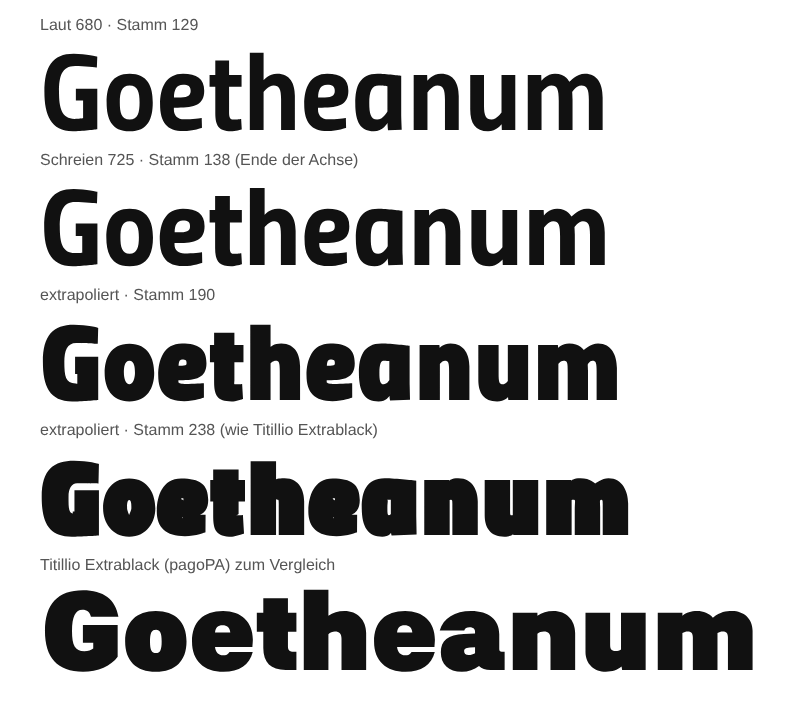

# Befund: Hausschrift v2.9 – Abgleich mit Titillium Sans Pro (Etappe E2)

Stand: 31. 10. 2026. Auftrag: Etappe E2 aus `docs/recherche_titillium-pro.md`
(Entscheid des Inhabers vom 31. 10. 2026), dazu E5 (Black-Probewort).
Quelle: https://github.com/chialab/titillium_pro, Branch `main`, Commit
`65ca153` (4. 2. 2026), UFO-Master Thin · Regular · Bold, OFL.
Vergleich im Browser: https://werkzeuge.goetheanum.ch/schrift-v29.html

Build: `tools/goetheanum-fontfix/build_v29_pro.py` (liest v2.8 aus git,
idempotent; zweiter Lauf bitgleich geprüft). Pro-Lesen in `pro_quelle.py`.

## Grundlage: Gewicht und Proportion

- **Gewicht passt genau.** Stamm des I: Pro Thin 36 = Flüstern 190, Pro Bold
  138 = Schreien 725, Pro Regular 78 ≈ 420. Jede Mischung geht darum ohne
  Extrapolation nach der Stammbreite zwischen den drei Mastern.
- **Proportion nicht.** Die Pro ist breiter gezeichnet: Versalien und
  Gemeine bei gleichem Stamm rund 8 % breiter (H 505 gegen 467), die Ränder
  im selben Mass weiter (Stamm-Rand 85 gegen 76). Ziffern sind gleich breit,
  aber enger gesetzt (Rand der 4: 33 gegen 64). Folge: Pro-Glyphen lassen sich
  nicht 1:1 einsetzen und das Kerning nicht 1:1 kopieren.

## 1 Zeichenbestand

Pro 607 Codepunkte, Hausschrift v2.8 411 (die 454 der Recherche zählen die
Glyphen von Titillium Upright). Pro hat 204 mehr, das Haus 8 eigene (`Ǻ ǻ ‐ ‑ ‒`,
Wortverbinder, zwei Altlasten im Privatbereich).

**Übernommen: 158 → v2.9 hat 569 Codepunkte.**

| Gruppe | Zahl | Wie |
|---|---|---|
| Buchstaben mit Akzent (IAST `ṛ ṝ ḷ ḹ ṃ ṇ ṅ ṣ ṭ ḍ ḥ`, Pinyin `ǎ ǐ ǒ ǔ`, `Ḃ Ḋ Ḟ Ṡ Ṫ Ȯ Ǩ Ȟ Ȳ Ḡ Ǫ Ḑ …`) | 95 | Grundbuchstabe + Akzent **der Hausschrift**; Lage nach vorhandenen Zeichen (Mitte des Akzents in `â`, `ţ`), sonst nach den Ankern der Pro, auf die Breite des Hausbuchstabens umgerechnet. Akzente unten: Punkt, Strich, Bogen aus dem Akzent oben, um die Lücke gespiegelt; Cedille und Ogonek aus `¸ ˛` |
| Brüche `⅐ … ⅞ ⅟ ↉` | 17 | Zähler + `⁄` + Nenner der Hausschrift, wie `frac` sie setzt |
| Kombinierende Akzente U+0300 … | 17 | Nullbreite; `ccmp` setzt 276 Folgen (Grund + Akzent) zum fertigen Zeichen |
| Aus der Pro: `Ə Ɛ ɛ Ɨ ɨ Ʉ ʉ Ɲ ɲ ℮ ₹ ₽ ₴ ฿ ○ ● ◌` | 17 | Pro-Master nach Stammbreite gemischt, auf die Hausproportion gestaucht (Buchstaben × 0,93, Zeichen × 0,98), Stamm ausgeglichen, Versalhöhe 700 → 690 |
| `IJ ij`, `ȷ`, `ə` (gedrehtes e), Leerzeichen U+205F | 5 | aus Hausglyphen |
| Aliase `μ Ω Δ fi fl`, U+2000/2001 | 7 | auf vorhandene Glyphen |

**Nicht übernommen, mit Grund:**
- `№` – im Beipackzettel bewusst weggelassen («im deutschen Satz gilt Nr.»).
- `₪` – in der Pro falsch geformt (https://github.com/chialab/titillium_pro/issues/12).
- Pfeile `← ↑ → ↓ ↔ ↕ ↖ ↗ ↘ ↙` – die Hausform ist ‹Goetheanum Pfeile›;
  eine zweite Pfeilform im Textfont wäre ein Widerspruch. **Entscheid offen:**
  Pfeile der Pfeile-Schrift in den Textfont spiegeln?
- Kreisziffern `① … ❾` – Etappe E3.
- Vietnamesisch gestapelt (`Ẫ Ằ Ễ Ỗ`) – das übrige Vietnamesisch fehlt beiden.
- `Ŀ ŀ ʼn` – von Unicode abgeraten (Katalanisch setzt `l·l`).
- `̒ ̓ ̵ ̸` – kein zusammengesetztes Zeichen dahinter.

Kapitälchen der neuen Buchstaben gibt es nicht (die Pro hat keine).

## 2 Kerning

**Regel.** Für Paare **formgleicher** Zeichen gilt das Kerning der Pro
(iKern), für alle übrigen bleibt das Hauskerning.
- Formgleich: in Pro und Haus vorhanden, nicht aus `a g y t l` (Upright-Form),
  nicht die Guillemets (Hausform G16), Breite und Höhe im Familienverhältnis
  (Breite Haus/Pro 0,84–1,08, Höhe 0,93–1,07). In Klar 433 Zeichen.
- Wert: Pro-Wert, nach Stammbreite zwischen den Mastern gemischt, × Breiten-
  verhältnis der Buchstaben (≈ 0,93), auf 4 Einheiten gerundet (bei 16 px
  0,06 px). Probe am optischen Abstand (Rand + Kern + Rand, skaliert): für
  Versalien dieselben Werte ±4. Für Ziffern gäbe der Abstand bis −180 (weil
  die Pro ihre Ziffern enger setzt) – darum die Skalierung, nicht der Abstand.
- Schreibweise: zwei Lookups mit getrennten Paarmengen (Pro als Klassen,
  Haus einzeln), ihre Werte addieren sich nie. Variable: Kerning je Master
  über eine GDEF-Variationstabelle (bisher fest).

**Umfang (Klar).** Haus v2.8: 22 252 Paare (aufgelöst). Davon bleiben 8253
(mit `a g y t l` oder den Guillemets); 27 340 Paare kommen
aus der Pro. Deutlich und Laut mehr (39 722 / 38 373), weil die Pro im Fetten
mehr Paare kernt.

**Stichproben Klar, vorher → nachher (Einheiten):**
AV −28 → −40 · AT −41 → −64 · LT −80 → −104 · AY −47 → −60 · To −74 → −80 ·
P. −74 → −100 · F. −66 → −96 · T. −53 → −72 · V. −48 → −64 · r. −46 → −64 ·
neu: 7. → −76 · 74 → −36 · "A → −52. Unverändert, weil Upright: Ta −74,
Tg −79, f. −36, Va −30, Wa −23. Im Satz angeschaut (Deutlich 64 px, Klar
20 px): Versalzeilen schliessen sich, Fliesstext ruhiger, nichts stösst an.

**Dateigrösse woff2:** Klar 29,1 → 33,9 KB (+16 %), Deutlich 29,9 → 34,7,
Variable 66 → 83 KB. Ohne Klassenbildung war es 44 bzw. 141 KB.

## 3 Chialabs korrupte Glyphen gegen AUDIT.md

Chialab veröffentlicht keine Liste; das README nennt die Reparatur nur
allgemein. Konkret sind: Google-Fonts-Issue
https://github.com/google/fonts/issues/1064 (Titillium Web schlecht
interpoliert: `≤ " ÷ ◊ $ € %`) und Chialab-Issues #12 (`₪`), #11 (Bruchstrich
in Black bewusst leicht), #8 (`↙` Kursiv). Abgleich:
- `÷ ◊ $ € %`: in v2.8 repariert (AUDIT 29. 10.), Prüfmass grün. `≤ "`: im
  Durchgang vom 29. 10. als heil geprüft.
- In der Pro geprüft (Master Thin/Regular/Bold): `« »` kreuzen nicht, `⁄`
  hat kleinen Vorschub (100–120), `&` wächst mit, `•` ist in jedem Gewicht
  gleich – wie unsere Reparaturen und Entscheide von v2.8.
- **Nachgezogen:** `¨` (AUDIT «geringfügig»): Vorschub schrumpfte 791 → 514,
  die Pro wächst 325 → 444. Neu symmetrisch aus der Tinte: 422 → 450.
  `ĺ` geprüft, heil (Akut wandert gleichmässig mit dem Stamm).
- `₪` aus der Pro nicht übernommen (siehe oben).

Prüfmass `proof_variable_axis.py --alle`: 733 Glyphen, 0 Verstösse. Aus der
Pro bewusst starr wie dort: `● ℮`; `Ɲ` wandert 46 statt 40 Einheiten wie in
den Pro-Mastern.

## 4 Vertikalmetriken

| | Pro | Haus v2.9 |
|---|---|---|
| typo Asc/Desc/Gap | 950 / −250 / 0 | 750 / −250 / 0 |
| win Asc/Desc | 1217 / 327 | 1114 / 306 |
| x-Höhe / Versalhöhe | 500 / 700 | 500 / 690 |

**Unverändert.** Mit 950 würde `line-height: normal` von 1,0 auf 1,2 Geviert
springen und jede Seite, Mail und Office-Vorlage verschieben; der Gewinn wäre
nur Platz über den Versalakzenten, den `winAscent/Descent` 1114/306 schon
decken (neue Zeichen reichen von −304, Komma unten, bis 958, `Ḿ` in Laut). Die Versalhöhe 690 ist Umriss, nicht
Metrik; geborgte Versalien werden darauf gebracht.

## 5 Lieferung

Statische Schnitte, Variable, Webfonts, Office-TTF, Beipackzettel, ZIPs auf
v2.9; Icons und Pfeile nur umbenannt. Für versandte Mails bleibt
`Goetheanum-Schrift-v2.8-Deutlich` (woff/woff2); Vergleichskopien der v2.8 in
`assets/fonts/goetheanum/Befund/`.

## 6 E5: Probewort über Laut hinaus

Linear über Schreien hinaus trägt die Achse bis etwa Stamm 190; bei Stamm 238
(wie Titillio Extrablack) laufen `e a G` zu und die Buchstaben verschmelzen,
weil die Hausschrift ihre Breite nicht mitwachsen lässt – ein Extrablack
bräuchte eigene, rund 20 % breitere Master.

## Offen

- Entscheid Inhaber: Pfeile der ‹Goetheanum Pfeile› in den Textfont spiegeln?
- Kapitälchen für die neuen Buchstaben (nur bei Bedarf).
