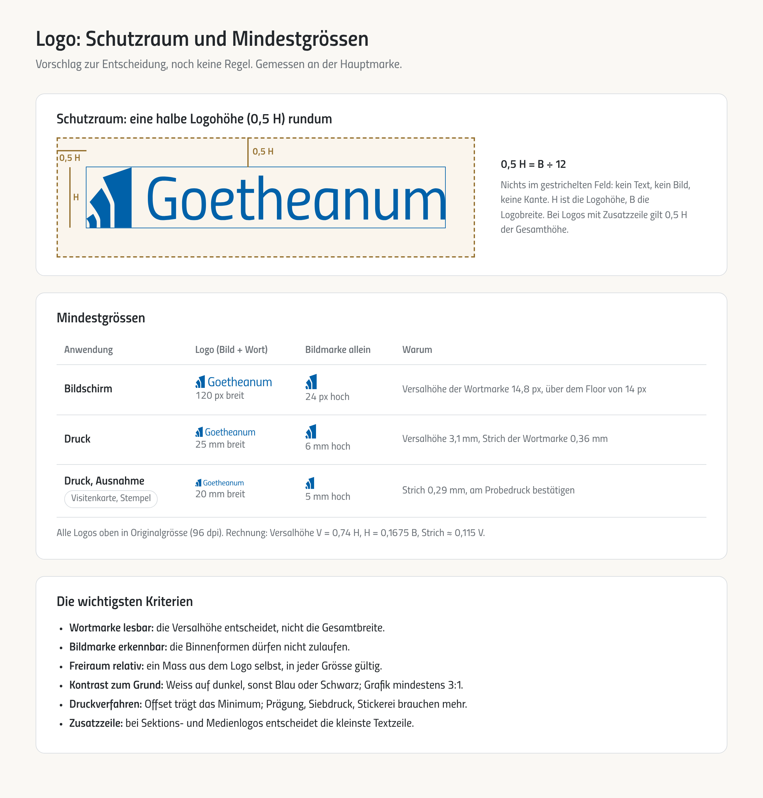

# Vorschlag: Schutzraum und Mindestgrössen der Logos

Stand 21. 11. 2026. **Vorschlag, keine Regel** – bis der Inhaber entscheidet.
Anlass: Frage von Joe (Design-Assistent von Louis Defèche); im Repo ist nichts
festgehalten (`docs/g-logo-anwendung/` nennt den Schutzraum nur als Prüfpunkt).

## Mass der Hauptmarke

Gemessen an `assets/logos/goetheanum-logo.svg` (viewBox 147,10 × 24,64):

| Teil | Mass | Verhältnis |
|---|---|---|
| Logohöhe H | 24,64 | 1 |
| Bildmarke | 18,45 × 24,6 | Breite 0,75 H |
| Versalhöhe der Wortmarke V | 18,2 | 0,74 H |
| Abstand Bildmarke – Wort | 6,7 | 0,27 H |
| Logobreite B | 147,10 | 5,97 H |

## Die wichtigsten Kriterien

1. **Wortmarke lesbar bei kleinster Verwendung.** Massgebend ist die Versalhöhe V,
   nicht die Gesamtbreite. Bildschirm: V ≥ 14 px (Floor B03). Druck: Strichstärke
   ≥ 0,25 mm (Stamm der Wortmarke ≈ 0,115 V).
2. **Bildmarke erkennbar.** Die Binnenformen dürfen nicht zulaufen; kleiner als unten
   genannt steht die Bildmarke nur als Favicon (eigene Regeln, `favicon.html`).
3. **Freiraum relativ, nicht in mm.** Ein Mass aus dem Logo selbst gilt in jeder
   Grösse und lässt sich im Layout abgreifen.
4. **Kontrast zum Grund.** Weiss auf dunklem Grund, sonst Blau oder Schwarz; Grafik
   ≥ 3:1 (B01, B02).
5. **Druckverfahren.** Offset trägt die Mindestgrösse; Prägung, Siebdruck, Stickerei
   verlangen mehr (je Verfahren ein Zuschlag, mit der Druckerei klären).
6. **Logos mit Zusatzzeile** (Sektionen, Medien): die kleinste Textzeile entscheidet.

## Vorschlag

**Schutzraum:** halbe Logohöhe rundum (½ H = B/12). Nichts im Schutzraum: Text, Bild
oder Kante. Bei Logos mit Zusatzzeile gilt ½ H der Gesamthöhe.

**Mindestgrössen**

| Anwendung | Logo (Bild + Wort) | Bildmarke allein |
|---|---|---|
| Bildschirm | 120 px breit (V = 14,8 px) | 24 px hoch |
| Druck | 25 mm breit (V = 3,1 mm, Stamm 0,36 mm) | 6 mm hoch |
| Druck, Ausnahme (Visitenkarte, Stempel) | 20 mm breit (Stamm 0,29 mm) | 5 mm hoch |

Rechnung: V = 0,74 H, H = B × 0,1675. 120 px → H = 20,1 px, V = 14,8 px.
25 mm → V = 3,1 mm, Stamm = 0,115 V = 0,36 mm.

## Offen für den Entscheid

- Schutzraum ½ H oder Versalhöhe V (0,74 H, grosszügiger).
- Gilt dasselbe für Sektions- und Medienlogos oder wird je Familie gemessen.
- Mindestgrössen am Probedruck bestätigen (Wortmarke 20 mm, Offset auf ungestrichenem Papier).
